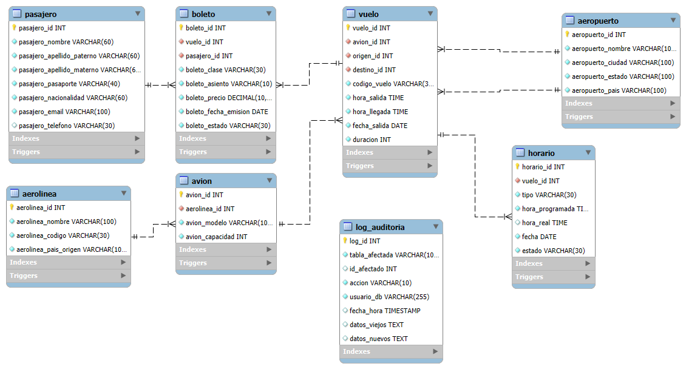

# AeroManage: sistema de gestión aeroportuaria

**Base de datos relacional en MySQL 8.0 con seguridad por roles, auditoría con triggers y un Plan de Recuperación de Desastres (DRP)**

Proyecto final de *Administración de Bases de Datos* · Matemáticas Aplicadas y Computación · FES Acatlán, UNAM · 2025
Equipo 10: **Gonzalo Sebastián Mera Montiel**, **Arturo Daniel Méndez Amel** y **Alan Giovanny Trejo Reséndiz**

📄 [Plan de Recuperación de Desastres](docs/DRP.pdf) · 📝 [Propuesta del proyecto](docs/Propuesta_AeroManage.pdf) · 🖥️ [Presentación](docs/AeroManage_presentacion.pdf)

---

## El problema

Las operaciones de un aeropuerto suelen depender de varias fuentes de información desconectadas, lo que genera retrasos, errores y poca capacidad de reacción ante cambios como retrasos, reasignaciones u *overbooking*. **AeroManage** centraliza vuelos, horarios, aerolíneas, aviones, pasajeros y boletos en una sola base de datos, con control de acceso por perfil y trazabilidad completa de los cambios.

## Modelo de datos



Siete tablas de negocio más una bitácora de auditoría: `aeropuerto`, `aerolinea`, `avion`, `vuelo`, `horario`, `pasajero`, `boleto` y `log_auditoria`.

## Qué incluye el script

El script completo está en [`sql/01_sistema_aeropuerto.sql`](sql/01_sistema_aeropuerto.sql).

| Área | Implementación |
|---|---|
| **Almacenamiento** | 6 *tablespaces* InnoDB (uno por tabla principal) y **particionamiento por rango** de `vuelo` por año de salida |
| **Carga de datos** | 6 procedimientos almacenados que generan **5,000 registros sintéticos por tabla**, respetando las dependencias entre tablas |
| **Integridad** | Llaves primarias y foráneas que se agregan con `ALTER TABLE` después de la carga de datos |
| **Seguridad** | 5 roles con privilegio mínimo: administrador, analista, agente de reservas, operaciones de vuelo y gestor de vuelos. Usuarios asignados por puesto |
| **Auditoría** | Tabla `log_auditoria` y **21 triggers** (INSERT, UPDATE y DELETE en las 7 tablas) que guardan usuario, fecha, datos anteriores y datos nuevos |
| **Recuperación** | DRP con un incidente simulado, detección por auditoría y restauración desde respaldo |

## Plan de Recuperación de Desastres

El [DRP](docs/DRP.pdf) simula un incidente real y lo resuelve paso a paso, con tiempos y responsables:

1. **Operación normal:** la analista consulta los vuelos registrados.
2. **Incidente:** un usuario con rol de *gestor* desactiva las llaves foráneas y borra la tabla `vuelo`.
3. **Detección:** la analista reporta que el sistema no responde.
4. **Investigación:** el administrador consulta `log_auditoria` e identifica quién hizo el borrado y cómo.
5. **Restauración:** recarga desde el último respaldo (`mysqldump`) con el cliente `mysql`.
6. **Verificación y cierre:** se confirma la operación y se documenta y reporta el incidente.

Del incidente al cierre: **unos 15 minutos** (de 7:35 a 7:50 en el ejercicio).

## Cómo ejecutarlo

1. Abre `sql/01_sistema_aeropuerto.sql` en MySQL Workbench (o en el cliente `mysql`) con un usuario administrador.
2. **Cambia las contraseñas** `CAMBIAR_PASSWORD` por las tuyas.
3. Ejecuta el script completo. Crea la base `sistema_aeropuertos`, carga los datos y configura roles, usuarios y triggers.
4. En [`sql/02_consultas_ejemplo.sql`](sql/02_consultas_ejemplo.sql) hay consultas de prueba.

Para probar el DRP, primero genera un respaldo:

```bash
mysqldump -u root -p sistema_aeropuertos > aeropuerto_backup.sql
```

## Estructura

```
├── sql/
│   ├── 01_sistema_aeropuerto.sql    Creación completa: tablas, datos, roles, auditoría
│   └── 02_consultas_ejemplo.sql     Consultas de prueba
├── diagramas/DiagramaER.png         Modelo entidad-relación
└── docs/                            DRP, propuesta y presentación
```

## Tecnologías

MySQL 8.0 · MySQL Workbench · SQL (DDL, DML, DCL) · procedimientos almacenados · triggers

---

Curso de Administración de Bases de Datos · FES Acatlán, UNAM. Los datos son sintéticos.
